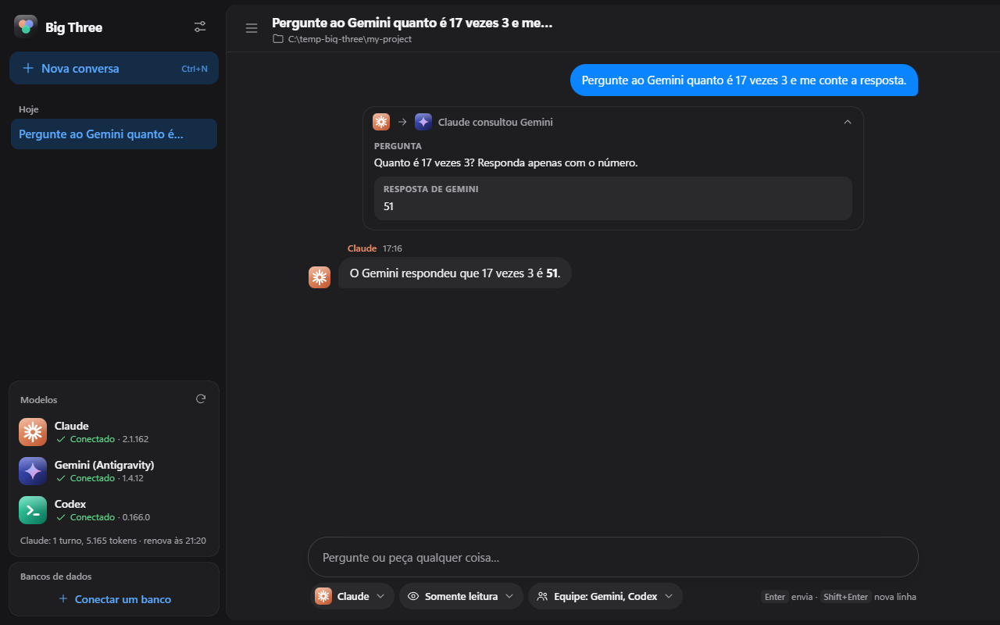
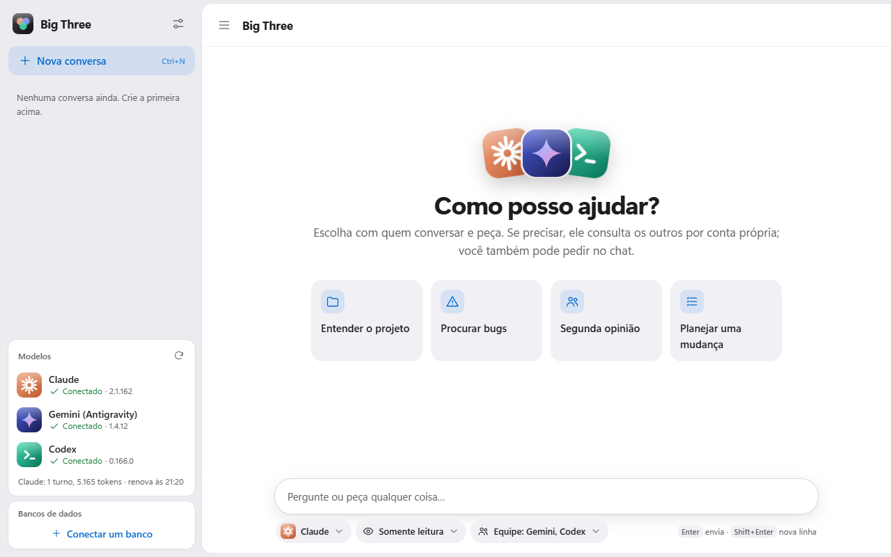
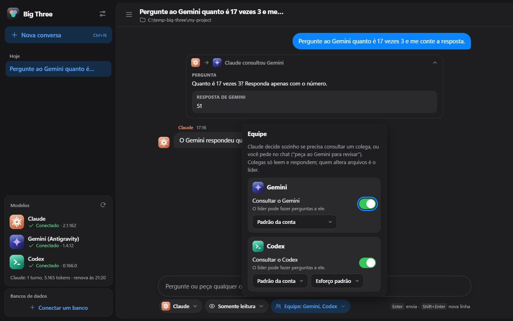
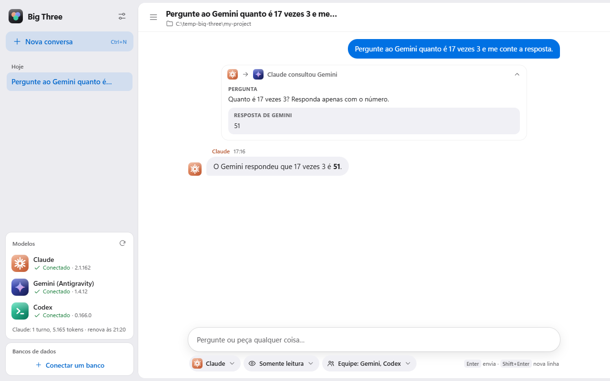
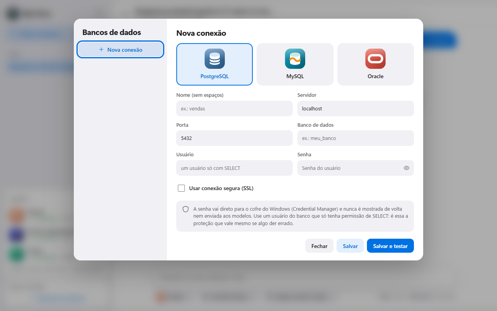
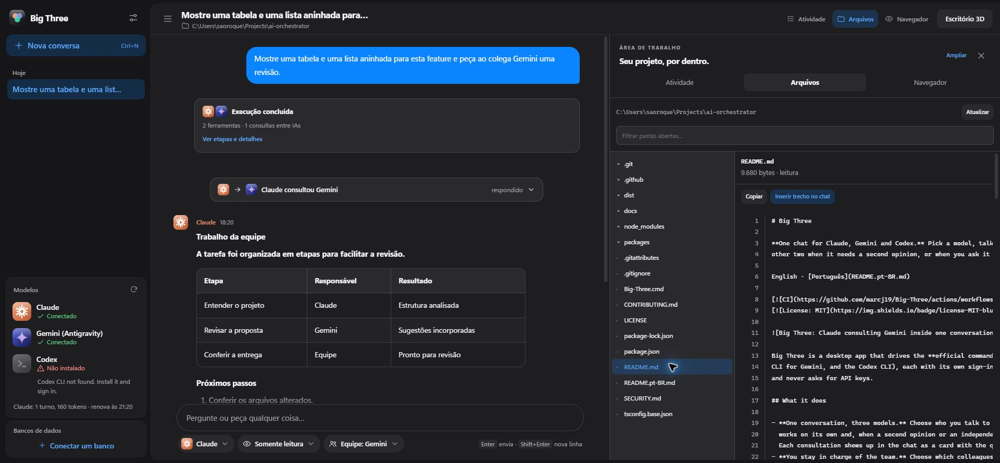
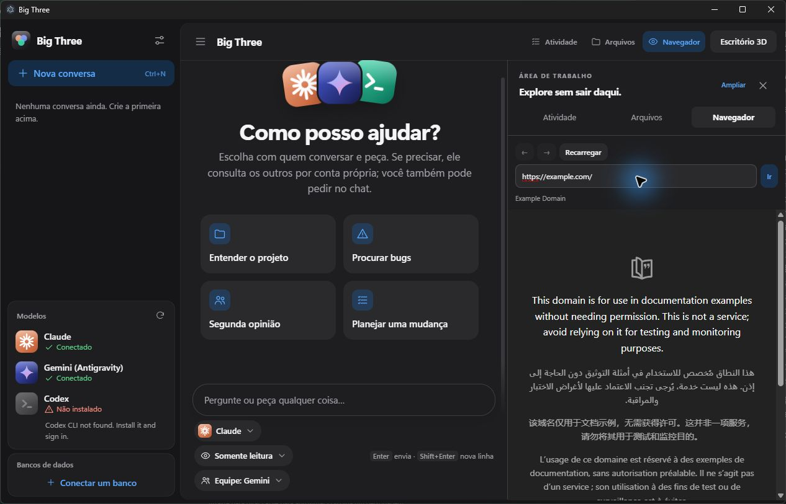
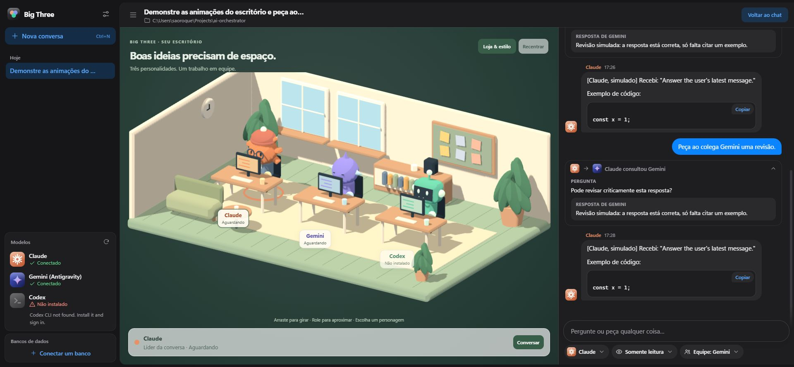
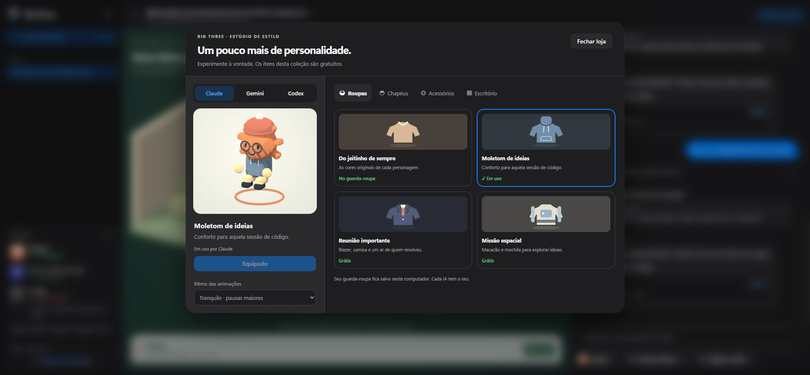

# Big Three

**One chat for Claude, Gemini and Codex.** Pick a model, talk to it like you would in Claude Code, and it consults the
other two when it needs a second opinion, or when you ask it to ("ask Gemini to review this").

English · [Português](README.pt-BR.md)

[](https://github.com/marcj19/Big-Three/actions/workflows/ci.yml)
[](LICENSE)



Big Three is a desktop app that drives the **official command-line tools** you already use (Claude Code, the Antigravity
CLI for Gemini, and the Codex CLI), each with its own sign-in and its own subscription limits. It never extracts tokens
and never asks for API keys.

## What it does

- **One conversation, three models.** Choose who you talk to (and the model and effort), then just write. That model
  works on its own and, when a second opinion or an independent review would clearly help, consults a teammate.
  Each consultation shows up in the chat as a card with the question and the answer.
- **You stay in charge of the team.** Choose which colleagues can be consulted and which model each one answers with.
  Colleagues only read and answer; **only the lead changes files**, and only with the access you gave it.
  Enable **Consultar equipe automaticamente** to collect the team's recommendations before the lead answers.
- **Safe by default.** Each conversation starts in read-only mode. Confirm expanded access once in the native dialog.
  The grant lasts for that conversation until you lower access or close the app.
- **Real model choice.** Claude (Opus, Sonnet, Haiku, pinned versions, effort), Gemini (everything your Antigravity
  account offers, including Claude and GPT-OSS models) and Codex (any model name, effort).
- **Database access without exposing credentials.** Connect PostgreSQL, MySQL or Oracle. Models can run `SELECT`
  queries through a broker; the password lives in your system vault and never reaches a model.
- **Accessible and light.** Light, dark or automatic theme, four text sizes, reduced motion, keyboard navigation, screen
  reader labels.

<table>
  <tr>
    <td></td>
    <td></td>
  </tr>
  <tr>
    <td></td>
    <td></td>
  </tr>
</table>

## Requirements

- **Windows 10 or 11** (developed and used on Windows 11; macOS and Linux are not tried yet, see
  [Platform support](#platform-support)).
- **[Node.js](https://nodejs.org) 20 or newer** to run from source or build the executable.
- **At least one of these CLIs, installed and signed in with your own account** (the more, the better the team):
  - **Claude Code** (`claude`), with a Claude subscription.
  - **Antigravity CLI** (`agy`), for Gemini, with a Google account.
  - **Codex CLI** (`codex`), with a ChatGPT account: `npm i -g @openai/codex`.

## Install and run

**Windows x64 installer.** Download and run **Big-Three-Setup-…-x64.exe** from the releases page. The installer adds
shortcuts to launch Big Three. Use **Atualizações** in the sidebar to download and install newer releases from the app.
[GitHub Releases](https://github.com/marcj19/Big-Three/releases)

**Portable Windows build:** after `npm ci`, run `npm run package:win` to generate the portable folder under `dist`.
Open **Big Three.exe** inside it. Keep the entire folder together because it contains Electron and the app's dependencies.

**From source:** download the project (green **Code** button, then **Download ZIP**, and unzip it), then
double-click **`Big-Three.cmd`**. The first run installs what it needs (a few minutes, including a one-time download of
the Electron runtime, about 110 MB). After that it opens right away.

**From a terminal:**

```bash
git clone https://github.com/marcj19/Big-Three.git
cd Big-Three
npm install
npm start
```

**Not sure which CLIs are ready?** Run `npm run doctor`. It lists each one, its version and whether it is signed in:

```text
Claude  ok  2.1.162 (Claude Code)  signed in: true
Gemini (Antigravity) ok  1.4.12  signed in: true
Codex   ok  codex-cli 0.166.0  signed in: true
```

You can also sign in from inside the app: the sidebar shows each model's status and an **Enter** button when one is
signed out.

## Using it

1. Click **New conversation** (`Ctrl+N`) and choose the folder the models may work in. They can see that folder and its
   subfolders, so start with the smallest scope that does the job.
2. Under the text field, pick **who you talk to**, **what it may do** (read, edit, or full access) and **the team**.
3. Write. Press `Enter` to send, `Shift+Enter` for a new line.
4. Ask for help in plain words whenever you like: *"ask Gemini to review this"*, *"get a second opinion from Codex before
   you change anything"*.

### Workspace and execution history

Click **Modelos** in the sidebar to collapse or expand the connection list. The preference is saved locally;
**Limites e uso** remains available while the list is collapsed.

**Limites e uso** separates this app session's tokens and turns from subscription quotas. For Codex signed in with
ChatGPT, it reads quota windows through the official App Server without creating a thread or running a model, cached
for up to one minute. For Claude, it shows windows and percentages reported by the CLI during runs; missing values are
not estimated. Windows past their reset time are marked as awaiting an update. It includes links to the Claude and
Codex usage dashboards and instructions for `/usage` in Antigravity (`agy`). Antigravity quotas are not read automatically.
Local counters exclude usage outside this app and reset when the app restarts.

Use **Atividade**, **Arquivos**, and **Navegador** in the top bar to open the workspace beside the chat.

- **Activity** shows observed execution stages, tools, teammate consultations, reported tokens, elapsed time, and a stop
  button. Completed run records are saved locally per conversation and remain available after reopening the app.
- **Files** explores the conversation's project folder and previews text with line numbers. It is read-only; **Inserir
  trecho no chat** adds a bounded excerpt to your draft for review before sending. Paths outside the project, including
  links pointing outside it, are rejected. Previews are limited to 256 KB and 2,500 lines.
- **Browser** opens HTTP(S) sites and localhost inside Electron, with back, forward, and reload controls. Response links
  open here too. The page uses a separate browser session without the app's privileged bridge. This is a browser for the
  user; it does not add autonomous browsing tools to the models. The development web preview offers an external tab instead.

Chat responses support tables, nested lists, checklists, quotes, and code blocks with language labels and copy controls.
Consultations stay collapsible, with a compact work summary linking to the execution timeline. Run records keep a short
prompt excerpt and activity metadata; they do not duplicate model answers or private instructions. Only completed runs
are persisted, so this is not recovery of an interrupted execution after a crash.





### Optional 3D office

Select **Escritório 3D** in the top bar, or enable it under **Aparência**. Claude, Gemini, and Codex each have a local,
animated cartoon mascot and a desk, with the chat alongside. Drag to orbit, scroll to zoom, and select a character or its
name. **Escolher como líder** changes the chat's selected provider without starting a run.

The setting starts off and is saved locally. The 3D engine loads only when enabled, pauses in the background, and releases
graphics resources when disabled. Reduced motion (including the system preference) keeps a static scene with live status
updates. If WebGL cannot start, the chat remains usable. Characters use procedural local geometry.

Speech bubbles and gestures follow real tool and run events: file reading and editing, terminal commands, search,
database queries, and replies. MCP consultations also animate the consulted colleague and waiting lead. Tool completion
returns the character to checking the result. Unknown tools use a generic gesture instead of guessing from prompt text.

Open **Loja & estilo** to try on and equip outfits, hats, and accessories in a live 3D fitting room, or recolor the office.
This collection is free; each AI has an independent combination and the wardrobe is saved locally. Trying an item does
not replace the equipped item until you choose **Resgatar grátis e equipar** or **Equipar**. The animation pace selector
defaults to **Tranquilo**, with longer rests and staggered gestures.





### Connecting a database

Create a database user that can **only `SELECT`** what the models may see, then open **Databases** in the sidebar,
choose the engine, fill in the connection and press **Save and test**. The password goes straight to the system vault
(Windows Credential Manager) and is never shown back or sent to a model. In each conversation you choose which
connections the models may query.

## How it stays safe

- **Conversation access.** A native dialog confirms each increase in access. The main process keeps the grant for that
  conversation while the app is open. Usage limit fallback applies only to read-only runs.
- **Web and browser permissions.** The **Permissions** chip under the text field has two switches, **Internet** (search
  and open pages) and **Browser** (Claude driving your Chrome through *Claude in Chrome*). Both start off. Turning one on
  asks in a native dialog, applies to that conversation only, and is forgotten when you close the app. Claude and Codex
  honour Internet; only Claude has a browser; Gemini's CLI offers no such switch, so the window says so. Colleagues that
  are consulted inherit Internet but never the browser. Codex's own connectors ("apps") stay off, because they bring their
  own web search and act on your linked accounts.
- **Colleagues cannot change anything.** A consulted model runs read-only and gets neither the room tools nor the database tools,
  so questions cannot fan out.
- **Database defence in depth:** a `SELECT`-only database user (the layer that matters), a SQL guard, read-only
  transactions, timeouts, row limits, sanitized errors and an audit log.
- **The window is sandboxed:** no Node in the page, a strict content security policy, model output always inserted as
  text, every call from the page validated by the main process.
- **Model CLIs run with a scrubbed environment**, without API keys or anything that looks like a credential.

One honest limit: the system vault belongs to your Windows user. A model that is allowed to run arbitrary commands as you
could read it the same way the broker does. That is why the database user should only have `SELECT`, and why models start
read-only. Details in [SECURITY.md](SECURITY.md).

## Platform support

Developed and used on **Windows 11**. The automated tests also run on Linux in CI, and the code avoids Windows-only
assumptions where it can (config folders follow each platform's convention, and the password vault is cross-platform).
But the app itself (the window, the vault, the model CLIs) has not been tried on macOS or Linux: for example, stopping a
model there signals only the process it started, not its children. Reports and fixes are welcome.

## Known limits

- **The interface is in Brazilian Portuguese** for now. Translations are welcome (see [CONTRIBUTING.md](CONTRIBUTING.md)).
- **Gemini can be consulted but cannot consult others or query databases.** The Antigravity CLI offers no clean way to
  attach tools to a single session yet, and changing its global configuration without asking would not be polite.
- **Codex has no model list** to choose from; use *Other…* and type a model name.

## Not affiliated

Big Three is an independent, unofficial project. It is not affiliated with, endorsed by or sponsored by Anthropic,
Google or OpenAI. *Claude*, *Gemini*, *Codex* and the other product names belong to their owners. The app drives the
official CLIs on your own accounts: you are responsible for following each provider's terms of use and for the
usage your subscriptions allow. The model and database icons are simplified originals in each product's colours, not
the official logos. Big Three itself sends nothing anywhere; the CLIs talk to their providers as they normally do.

## Contributing, security, license

- [CONTRIBUTING.md](CONTRIBUTING.md): how to run the tests and what to keep in mind.
- [SECURITY.md](SECURITY.md): how to report a vulnerability, and the threat model.
- [docs/ARCHITECTURE.md](docs/ARCHITECTURE.md): how the pieces fit together.
- Released under the [MIT License](LICENSE).
