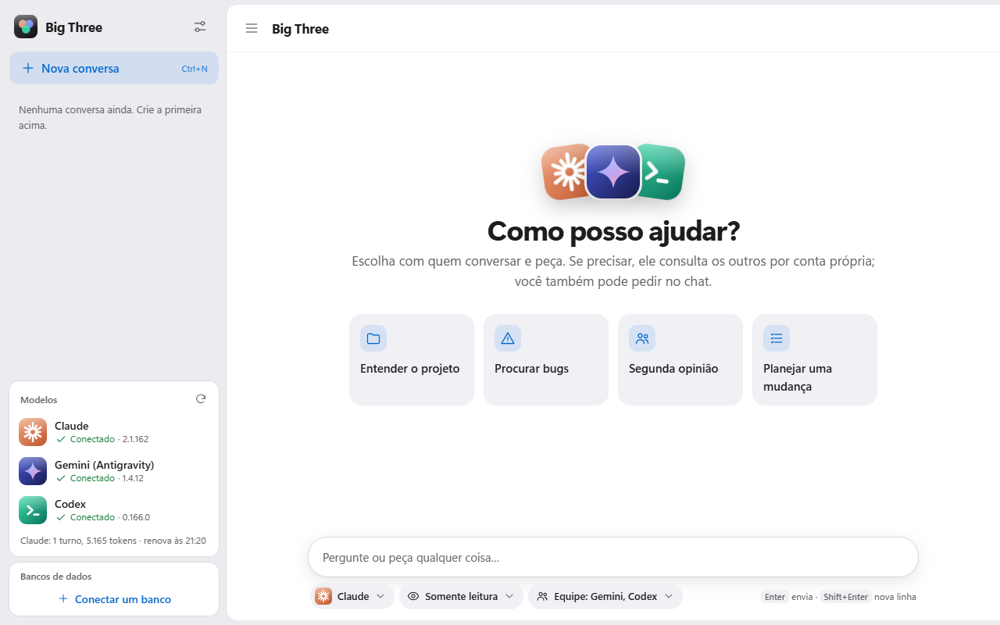
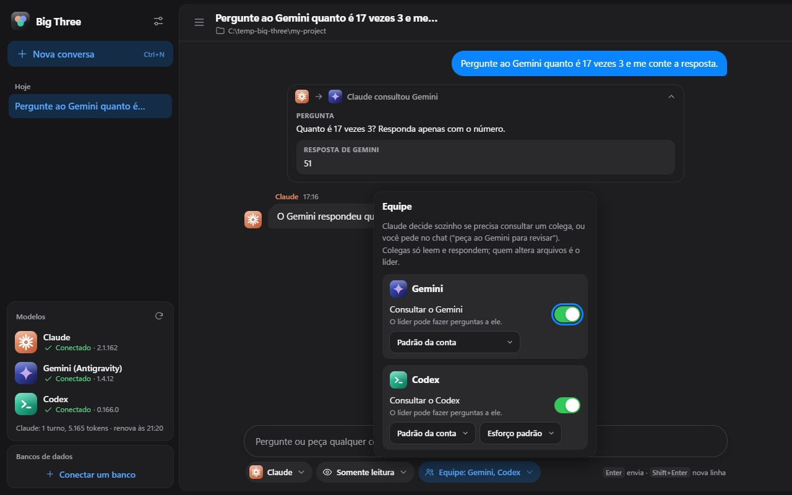
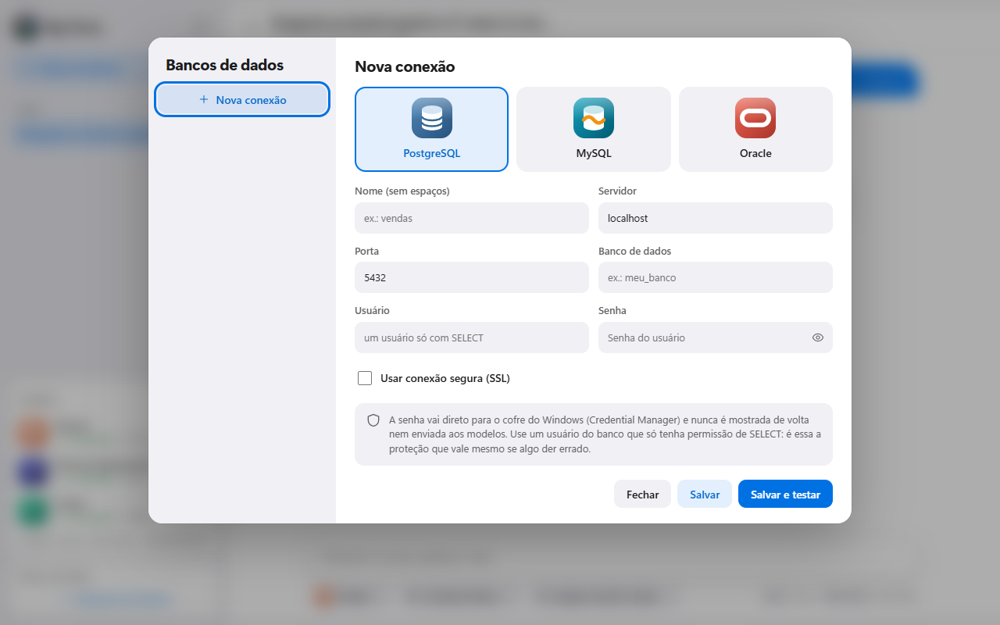

# Big Three

**Um chat só para Claude, Gemini e Codex.** Escolha um modelo, converse como no Claude Code, e ele consulta os outros dois
quando precisa de uma segunda opinião, ou quando você pede ("peça ao Gemini para revisar isto").

[English](README.md) · Português

[](https://github.com/marcj19/Big-Three/actions/workflows/ci.yml)
[](LICENSE)


O Big Three é um app de desktop que usa as **ferramentas de linha de comando oficiais** que você já tem (Claude Code, a CLI
do Antigravity para o Gemini e a CLI do Codex), cada uma com o próprio login e os próprios limites da sua assinatura. Ele
nunca extrai tokens e nunca pede chaves de API.

## O que ele faz

- **Uma conversa, três modelos.** Escolha com quem você fala (e o modelo e o esforço) e escreva. Esse modelo trabalha
  sozinho e, quando uma segunda opinião ou uma revisão independente ajudaria de verdade, consulta um colega. Cada
  consulta aparece no chat como um cartão com a pergunta e a resposta.
- **Você manda na equipe.** Escolha quais colegas podem ser consultados e com que modelo cada um responde. Os colegas só
  leem e respondem; **só o líder altera arquivos**, e apenas com o acesso que você deu.
- **Seguro por padrão.** Os modelos começam em somente leitura. Deixar um editar arquivos ou rodar comandos pede a sua
  confirmação numa janela nativa, toda vez.
- **Escolha real de modelo.** Claude (Opus, Sonnet, Haiku, versões fixas, esforço), Gemini (tudo o que a sua conta do
  Antigravity oferece, incluindo modelos Claude e GPT-OSS) e Codex (qualquer nome de modelo, esforço).
- **Acesso a banco de dados sem expor credenciais.** Conecte PostgreSQL, MySQL ou Oracle. Os modelos podem rodar consultas
  `SELECT` por um intermediário; a senha fica no cofre do sistema e nunca chega a um modelo.
- **Acessível e leve.** Tema claro, escuro ou automático, quatro tamanhos de texto, movimento reduzido, navegação pelo
  teclado e rótulos para leitores de tela.

<table>
  <tr>
    <td></td>
    <td></td>
  </tr>
  <tr>
    <td></td>
    <td></td>
  </tr>
</table>

## Requisitos

- **Windows 10 ou 11** (desenvolvido e testado no Windows 11; macOS e Linux ainda não foram testados, veja
  [Suporte a plataformas](#suporte-a-plataformas)).
- **[Node.js](https://nodejs.org) 20 ou mais novo.**
- **Pelo menos uma destas CLIs, instalada e com login na sua própria conta** (quanto mais, melhor a equipe):
  - **Claude Code** (`claude`), com uma assinatura do Claude.
  - **CLI do Antigravity** (`agy`), para o Gemini, com uma conta Google.
  - **CLI do Codex** (`codex`), com uma conta do ChatGPT: `npm i -g @openai/codex`.

## Instalar e abrir

**O jeito mais fácil no Windows:** baixe o projeto (botão verde **Code**, depois **Download ZIP**, e descompacte) e dê dois
cliques em **`Big-Three.cmd`**. Na primeira vez ele instala o que precisa (alguns minutos, incluindo o download único do
Electron, cerca de 110 MB). Depois disso abre na hora.

**Pelo terminal:**

```bash
git clone https://github.com/marcj19/Big-Three.git
cd Big-Three
npm install
npm start
```

**Não sabe quais CLIs estão prontas?** Rode `npm run doctor`. Ele lista cada uma, a versão e se está com login feito:

```text
Claude  ok  2.1.162 (Claude Code)  signed in: true
Gemini (Antigravity) ok  1.4.12  signed in: true
Codex   ok  codex-cli 0.166.0  signed in: true
```

Você também pode entrar de dentro do app: a barra lateral mostra o estado de cada modelo e um botão **Entrar** quando algum
está desconectado.

## Como usar

1. Clique em **Nova conversa** (`Ctrl+N`) e escolha a pasta em que os modelos podem trabalhar. Eles enxergam essa pasta e as
   subpastas, então comece pelo menor escopo que resolve.
2. Embaixo do campo de texto, escolha **com quem você fala**, **o que ele pode fazer** (ler, editar ou acesso total) e **a
   equipe**.
3. Escreva. `Enter` envia, `Shift+Enter` quebra a linha.
4. Peça ajuda com palavras simples quando quiser: *"peça ao Gemini para revisar isto"*, *"peça uma segunda opinião ao Codex
   antes de mudar qualquer coisa"*.

### Conectando um banco de dados

Crie um usuário no banco que **só tenha `SELECT`** no que os modelos podem ver, abra **Bancos de dados** na barra lateral,
escolha o motor, preencha a conexão e clique em **Salvar e testar**. A senha vai direto para o cofre do sistema (Credential
Manager do Windows) e nunca é mostrada de volta nem enviada a um modelo. Em cada conversa você escolhe quais conexões os
modelos podem consultar.

## Como ele se mantém seguro

- **Somente leitura, a menos que você diga o contrário.** Escrita é confirmada por uma janela nativa que a página não
  consegue responder. Não é lembrada entre sessões, e um limite de uso nunca passa para outro modelo uma tarefa que pode
  alterar arquivos.
- **Colegas não alteram nada.** Um modelo consultado roda só lendo e não recebe as ferramentas da sala nem as do banco, então as
  perguntas não se multiplicam.
- **Defesa em camadas no banco:** usuário só com `SELECT` (a camada que importa), um filtro de SQL, transações somente
  leitura, tempo limite, limite de linhas, erros sanitizados e um registro de auditoria.
- **A janela é isolada:** sem Node na página, política de segurança de conteúdo rígida, a saída dos modelos sempre inserida
  como texto e cada chamada da página validada pelo processo principal.
- **As CLIs rodam com o ambiente limpo**, sem chaves de API nem nada que pareça credencial.

Um limite, dito com franqueza: o cofre do sistema pertence ao seu usuário do Windows. Um modelo que possa rodar comandos
quaisquer como você conseguiria lê-lo do mesmo jeito que o intermediário faz. Por isso o usuário do banco deve ter só
`SELECT`, e por isso os modelos começam em somente leitura. Detalhes em [SECURITY.md](SECURITY.md).

## Suporte a plataformas

Desenvolvido e testado no **Windows 11**. O código evita suposições exclusivas do Windows quando pode (as pastas de
configuração seguem a convenção de cada sistema e o cofre de senhas é multiplataforma), mas macOS e Linux não foram
testados: por exemplo, para interromper um modelo nesses sistemas só o processo iniciado recebe o sinal, e não os filhos
dele. Relatos e correções são bem-vindos.

## Limites conhecidos

- **A interface está em português do Brasil** por enquanto. Traduções são bem-vindas (veja [CONTRIBUTING.md](CONTRIBUTING.md)).
- **O Gemini pode ser consultado, mas não consulta outros nem acessa bancos.** A CLI do Antigravity ainda não tem um jeito
  limpo de acoplar ferramentas a uma única sessão, e mudar a configuração global dela sem perguntar não seria educado.
- **O Codex não tem lista de modelos** para escolher; use *Outro…* e digite o nome de um modelo.
- **Ainda não há instalador.** O app roda a partir da pasta do código; o empacotamento está nos planos.

## Sem vínculo oficial

O Big Three é um projeto independente e não oficial. Não é afiliado, endossado nem patrocinado pela Anthropic, pelo Google
ou pela OpenAI. *Claude*, *Gemini*, *Codex* e os demais nomes de produto pertencem aos seus donos. O app usa as CLIs oficiais
nas suas próprias contas: você é responsável por seguir os termos de uso de cada provedor e pelo uso que as suas assinaturas
permitem. Os ícones de modelos e bancos são desenhos originais simplificados nas cores de cada produto, não os logotipos
oficiais. O Big Three em si não envia nada a lugar nenhum; as CLIs falam com os provedores como sempre.

## Contribuir, segurança, licença

- [CONTRIBUTING.md](CONTRIBUTING.md): como rodar os testes e o que ter em mente.
- [SECURITY.md](SECURITY.md): como relatar uma vulnerabilidade e o modelo de ameaças.
- [docs/ARCHITECTURE.md](docs/ARCHITECTURE.md): como as peças se encaixam.
- Distribuído sob a [Licença MIT](LICENSE).
